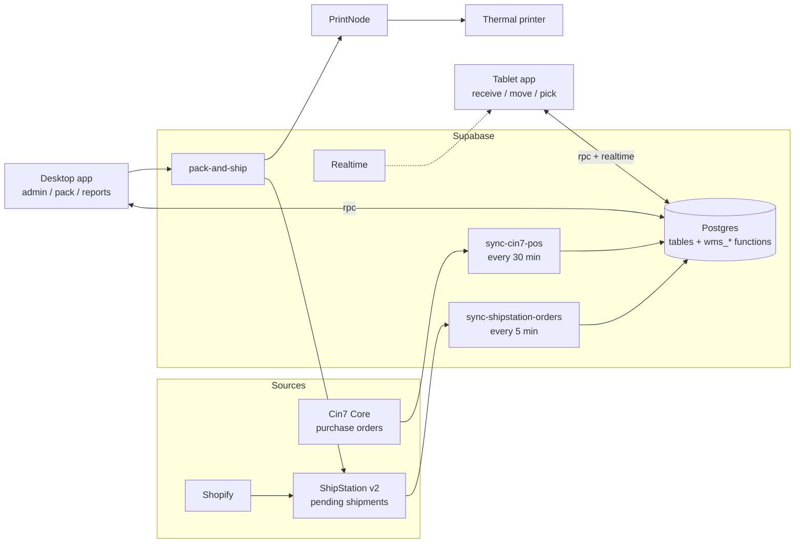
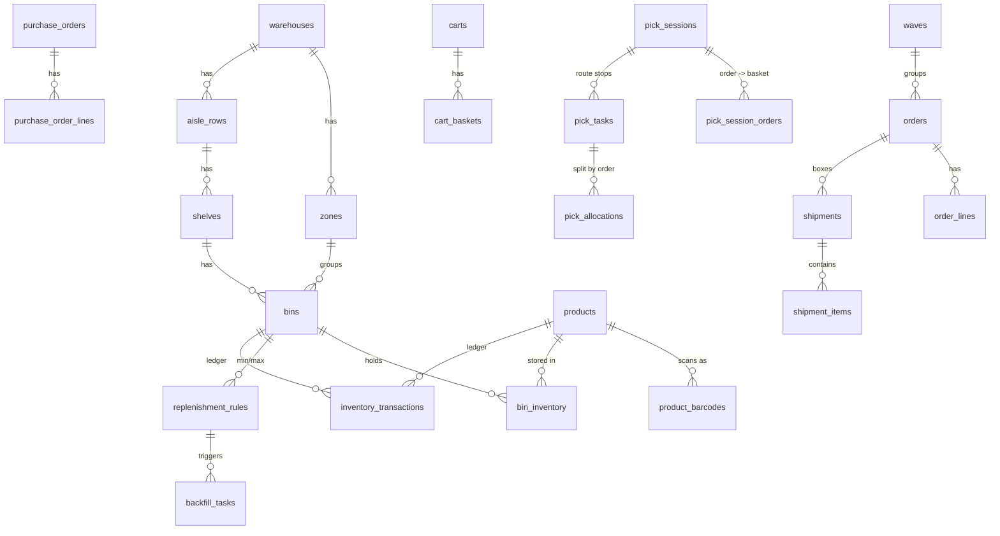

# TWL WMS: system architecture

A SkuVault-style warehouse management system for TWL HQ (217 South Rd, Ridleyton). Supabase is the single source of truth for **where every unit physically is**. Cin7 Core supplies inbound POs, ShipStation supplies outbound orders and buys labels.

## 1. Ecosystem

| Layer | Choice | Why |
|---|---|---|
| Database | Supabase Postgres (project `WMS.github`) | Transactions + row locks stop two pickers grabbing the same unit |
| Business logic | Postgres functions (`wms_*`) | One place for rules; both apps call the same function; atomic |
| Integrations | Supabase Edge Functions (Deno) | Keeps API keys server-side |
| Scheduling | `pg_cron` + `pg_net` calling the edge functions | No extra server |
| Tablet app | React (Vite) PWA, installed to home screen | Bluetooth scanners act as a keyboard, so a web app works; no app store |
| Desktop app | React (Vite) web app | Same codebase and components as the tablet |
| Printing | PrintNode (already installed on Ben's Mac) | Cloud-to-local-printer without drivers in the browser |

## 2. Data model

Key design decisions:

- **SKU-to-bin** lives in `bin_inventory (bin_id, product_id, qty_on_hand, qty_allocated)`. One SKU can sit in many bins; a bin can hold many SKUs.
- **Allocated vs on hand**: creating a pick session reserves stock (`qty_allocated`). It only leaves the bin when the picker scans it. Available = on hand - allocated.
- **Append-only ledger**: every receive, move, pick, adjustment writes an `inventory_transactions` row through one internal function (`wms__apply_delta`). The smoke test checks ledger total = live balance for every bin.
- **Barcodes**: bins print as `LOC:ADL:A-02-04`, baskets `BSK:03-04`, carts `CART:03`. Prefixes mean one scan box can tell what was scanned (`wms_resolve_scan`). Products resolve through `product_barcodes` (UPC/EAN, SKU, carton barcodes with `units_per_scan`).
- **Security**: Row Level Security on every table. Staff can read. Only admin/supervisor can edit layout and products. Stock, picks and orders can **only** change through the `wms_*` functions, never by editing a table directly.

Full DDL: `supabase/migrations/20261031000001_core_schema.sql`.

## 3. Inbound

| Step | Tablet | Function |
|---|---|---|
| Pick PO | List of open POs (synced from Cin7) | `select` on `purchase_orders` |
| Scan item | Product barcode, checked against the PO | `wms_receive_scan` returns `NOT_ON_PO` / `OVER_RECEIPT` |
| Scan bin | Bin label | same call, +qty to that bin, ledger row, PO line updated |

**Move location**: scan from-bin, scan SKU, enter qty, scan to-bin, `wms_move_stock`. Only free stock (not allocated to a pick) can be moved.

**Backfill alerts**: `replenishment_rules` sets min/max per pick bin + SKU. A trigger on `bin_inventory` opens a `backfill_tasks` row the moment the pick face hits min, suggesting the overstock bin with the most stock and the qty to top up to max. Moving stock into that bin closes the task automatically. If no overstock exists, the task has no source bin, which is the signal to reorder.

## 4. Outbound picking methods

All methods use one builder, `wms_create_pick_session(method, orders, cart, zone, ...)`:

| Method | How it is created | Baskets | Notes |
|---|---|---|---|
| Discrete | 1 order | optional tote | |
| Batch | many orders | none | One tote, sorted at the pack bench |
| Cluster | many orders + cart | 1 per order | Same SKU across orders = one stop, split into baskets |
| Wave | supervisor tags orders with a `wave` (eg "AusPost Express 2pm"), `wms_release_wave` splits into cart-sized sessions | cart scanned at start | |
| Zone | one session per zone with `p_zone_id` | cart passed zone to zone | Only one active session per cart at a time |
| Hyper | picker taps "Give me work": `wms_hyper_next_session` | cart scanned | Greedy clustering to minimise rows walked |

Routing and the scan-to-pick gate: see [PICK_ROUTING.md](PICK_ROUTING.md).

## 5. Pack and ship

Scan basket or order, scan every item into the box (wrong item = alarm), pick box/weight, then the `pack-and-ship` edge function updates ShipStation, buys the label and prints it. Payloads: [SHIPSTATION_PAYLOADS.md](SHIPSTATION_PAYLOADS.md).

## 6. Reporting (views)

| View | What it answers |
|---|---|
| `v_product_stock` | Pick vs overstock vs allocated vs available per SKU |
| `v_reorder_suggestions` | Projected stock (available + on PO - unallocated demand) vs safety stock. **RED** at or below safety stock, **AMBER** at or below reorder point, **GREEN** above. Suggested order qty |
| `v_picker_daily` | Units picked, sessions, avg session minutes, units per hour, scan accuracy % per person per day (Adelaide time) |
| `v_velocity_abc` | 90-day pick frequency: **A** = top 80% of picks, **B** = next 15%, **C** = rest, plus a re-slot hint (A items at the back, C items in prime bins) |

`wms_refresh_velocity_classes()` writes the ABC class back to `products` (schedule nightly).

## 7. Decisions needed from TWL before go-live

1. **Who owns stock numbers for Shopify?** Today Cin7 pushes stock to Shopify. Recommended: Cin7 stays the accounting/stock-value system, the WMS owns bin locations, and a nightly job compares WMS totals vs Cin7 per SKU (variance report). Receiving in the WMS does **not** yet tell Cin7 the PO was received. That write-back is phase 2.
2. **Bundles** (eg "Everyday Tee + Flex Shorts"): ShipStation lists the component SKUs, which is what the WMS picks. Confirm that is true for every bundle app TWL uses.
3. **SKUs with locations baked in** (eg `RBN-106306-010533 AH/B10/L4`): clean these up in Shopify before importing products, otherwise they will not match.
4. **Carrier rules**: the edge function uses ShipStation's carrier/service if automation set one, else AusPost Parcel Post or Express Post (if the customer chose express). International needs a service set in ShipStation first.
5. **Hardware**: tablet model, Bluetooth scanner (must support keyboard/HID mode), thermal printer per bench (4x6, ZPL or PDF), optional USB scale.

## 8. Build phases

| Phase | Scope | Exit test |
|---|---|---|
| 0. Foundation (done) | Schema, functions, routing, smoke test, edge functions | `supabase/tests/smoke_test.sql` passes |
| 1. Layout + products | Import products from Shopify, build rows/shelves/bins, print bin labels | Every bin label scans in `wms_resolve_scan` |
| 2. Inbound + count | Cin7 PO sync, tablet receive + move, full stocktake into bins | WMS totals match Cin7 within tolerance |
| 3. Pick | ShipStation order sync, tablet cluster/hyper picking | 1 week parallel run, 99.9% scan accuracy |
| 4. Pack + ship | Desktop pack bench, test labels, then live labels | Labels print in under 5 sec |
| 5. Reports | Picker metrics, ABC re-slotting, reorder list | Weekly review in the team meeting |
