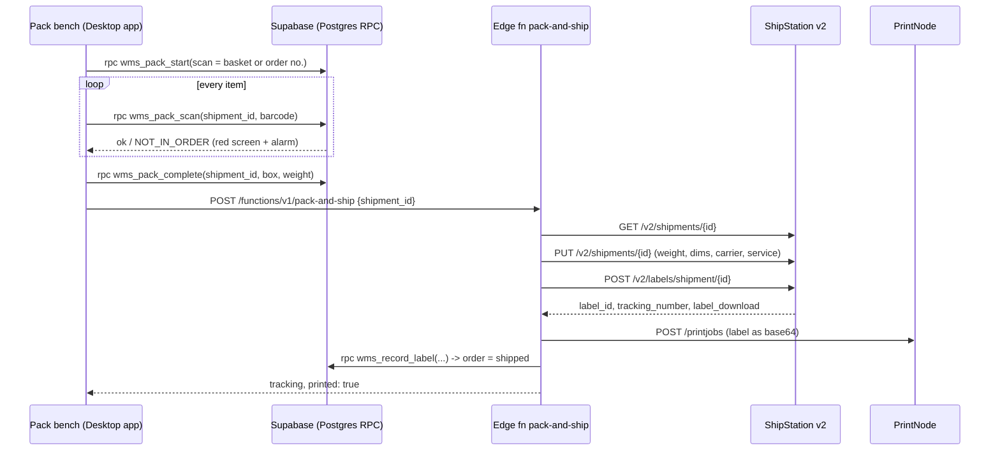

# Pack-to-label: API payloads (Desktop app, Supabase, ShipStation v2, PrintNode)

TWL's ShipStation account runs on the **v2 API** (`https://api.shipstation.com/v2`). Every Shopify order already lands in ShipStation as a **shipment** with `shipment_status: "pending"`. The WMS never creates orders in ShipStation. It finds the existing shipment, writes the real weight and box size onto it, then buys the label against it. That keeps ShipStation's Shopify notifications and tracking emails working exactly as they do today.

Values below come from TWL's live account (checked 31 Oct 2026):

| Thing | Value |
|---|---|
| ShipStation warehouse (ship from 217 South Rd, Ridleyton) | `se-96460` |
| Australia Post carrier | `se-1821526` |
| AusPost Parcel Post + Signature | `au_post_parcel_post_signature_3D85` |
| AusPost Express Post + Signature | `au_post_express_post_signature_3J35` |
| DHL Express AU carrier | `se-2010122` |
| Aramex AU carrier | `se-2010255` (`fastway_au_standard`) |
| WMS order number | ShipStation `shipment_number` (eg `564704`) |
| Shopify order id | ShipStation `external_shipment_id` |

## Sequence



## 1. Desktop app to Supabase (Postgres functions)

All calls use the logged-in user's session (`supabase.rpc(...)`).

**Start packing** (scan basket `BSK:03-04` or order `#564704`)
```json
// request
{ "p_scan": "BSK:03-04", "p_pack_station_id": "6b1c...", "p_device_id": "a91e..." }
// response
{
  "ok": true, "shipment_id": "0d3f...", "status": "packing", "complete": false,
  "order": { "id": "77aa...", "order_number": "564704", "customer": "Juli Hoven",
             "requested_service": "FREE EXPRESS SHIPPING - Authority to Leave", "ship_to": { "...": "..." } },
  "lines": [
    { "order_line_id": "c1..", "sku": "TWL-MENS-WOZ-3-23", "name": "Men's Everyday Tee - XL",
      "qty_ordered": 1, "qty_picked": 1, "qty_packed": 0, "remaining": 1, "image_url": "https://..." }
  ]
}
```

**Scan each item**
```json
{ "p_shipment_id": "0d3f...", "p_barcode": "194830935202" }
// good -> same shape as above with qty_packed incremented
// bad  -> { "ok": false, "error": "NOT_IN_ORDER", "alarm": true, "scanned_sku": "RBK-G58695-11" }
//         { "ok": false, "error": "ALREADY_PACKED", "alarm": true, "sku": "..." }
```

**Close the box**
```json
{ "p_shipment_id": "0d3f...", "p_package_type_id": "satchel-a3 uuid", "p_weight_grams": 1250 }
// p_weight_grams optional: falls back to sum(product weights) + box tare
// -> { "ok": true, "next": "call edge function pack-and-ship", ... }
```

## 2. Desktop app to edge function

```http
POST https://<project>.supabase.co/functions/v1/pack-and-ship
Authorization: Bearer <user access token>
Content-Type: application/json

{ "shipment_id": "0d3f..." }
```
Response
```json
{ "ok": true, "order_number": "564704", "tracking_number": "33ABC1234567",
  "carrier": "australia_post", "service": "au_post_express_post_signature_3J35",
  "cost": { "currency": "aud", "amount": 12.45 },
  "printed": true, "print_error": null, "test_label": false,
  "label_url": "https://api.shipstation.com/v2/downloads/..." }
```
Errors return `ok: false` with a readable message, eg `NEEDS_SERVICE: no carrier/service set for this order (international?)` or `ALREADY_LABELLED in ShipStation`.

## 3. Edge function to ShipStation v2

Header on every call: `API-Key: <SHIPSTATION_API_KEY>`

**3a. Find the shipment**
```http
GET /v2/shipments/se-35477754
GET /v2/shipments/external_shipment_id/4057448874154      (fallback)
```
Guard rails: stop if `shipment_status` is `label_purchased` (already shipped, avoid a double label) or `cancelled`.

**3b. Write exact weight, box and service** (PUT replaces the shipment, so send back the GET body minus read-only fields)
```json
PUT /v2/shipments/se-35477754
{
  "carrier_id": "se-1821526",
  "service_code": "au_post_express_post_signature_3J35",
  "warehouse_id": "se-96460",
  "ship_to":   { "name": "Juli Hoven", "address_line1": "3 Moonbeam Crescent", "city_locality": "Castaways Beach",
                 "state_province": "QLD", "postal_code": "4567", "country_code": "AU", "phone": "0407 033 953" },
  "ship_from": { "...": "unchanged from GET" },
  "external_shipment_id": "4057448874154",
  "shipment_number": "564704",
  "packages": [{
    "package_code": "aust_post_satchel",
    "weight":     { "value": 1250, "unit": "gram" },
    "dimensions": { "unit": "centimeter", "length": 42, "width": 30, "height": 8 },
    "label_messages": { "reference1": "#564704" }
  }]
}
```

**3c. Buy the label**
```json
POST /v2/labels/shipment/se-35477754
{ "label_format": "pdf", "label_layout": "4x6", "label_download_type": "url", "test_label": false }
```
Response (fields the WMS stores)
```json
{
  "label_id": "se-123456789",
  "shipment_id": "se-35477754",
  "status": "completed",
  "tracking_number": "33ABC1234567",
  "carrier_id": "se-1821526", "carrier_code": "australia_post",
  "service_code": "au_post_express_post_signature_3J35",
  "shipment_cost": { "currency": "aud", "amount": 12.45 },
  "label_download": { "href": "https://.../label.pdf", "pdf": "https://.../label.pdf", "zpl": "https://.../label.zpl" }
}
```
Buying the label moves the ShipStation shipment to `label_purchased`, which is what marks the Shopify order fulfilled with tracking (using your existing store notification settings).

## 4. Edge function to PrintNode

```http
POST https://api.printnode.com/printjobs
Authorization: Basic base64(<PRINTNODE_API_KEY>:)
Content-Type: application/json
```
```json
{
  "printerId": 73012345,
  "title": "TWL #564704 33ABC1234567",
  "contentType": "pdf_base64",
  "content": "JVBERi0xLjQK...",
  "source": "TWL WMS",
  "expireAfter": 600
}
```
Response is the print job id as a bare number, eg `8812345`. Use `"contentType": "raw_base64"` with a ZPL label for Zebra printers (set `pack_stations.label_format = 'zpl'`).

## 5. Edge function back to Supabase

```json
rpc wms_record_label {
  "p_shipment_id": "0d3f...", "p_ok": true,
  "p_ss_shipment_id": "se-35477754", "p_label_id": "se-123456789",
  "p_tracking": "33ABC1234567", "p_label_url": "https://...", "p_cost": 12.45,
  "p_carrier_id": "se-1821526", "p_service_code": "au_post_express_post_signature_3J35",
  "p_printnode_job_id": 8812345
}
```
Sets the shipment to `shipped` (or `label_created` if printing failed), stamps tracking and cost, and closes the WMS order as `shipped`. Every external call is also written to `integration_log` with the request, response and timing, so any failed label can be traced.

## Safety rules built in

- A shipment can only be sent once: the function flips it `packed -> label_requested` atomically, so a double click cannot buy two labels.
- After a label is bought, a print failure never marks the order failed (a retry would buy a second label). The bench gets `printed: false` and the `label_url` to reprint.
- `TEST_LABELS=true` (the default) buys test labels only. Switch to `false` when going live.
- End of day: Australia Post needs a manifest. Keep doing it in ShipStation for now, or add `POST /v2/manifests` as a scheduled job later.
